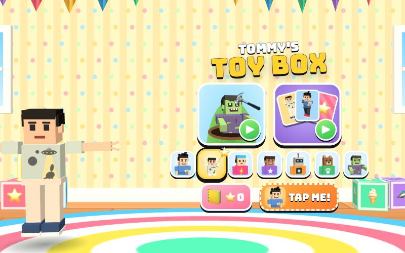

# Tommy's Toy Box

[](https://adong.github.io/tommy-toybox/)

Two gentle mini-games for a 5-year-old, starring Tommy and Teddy: **Whack-a-Zombie** (打地鼠) and **Memory Cards** (翻牌). It's built with Claude Code from plain JavaScript and Three.js, in the same style as Metro Surfer.
There are no image, model or audio files. The characters come from the shared kit (`kit/`), the zombie heads, hammer, garden and playroom are boxes and canvas textures, and every sound is synthesised.

"Tommy's Toy Box" is a working title. It lives in one place, `js/title.js`, and the page title and logo both read it.

## Play

- **Double-click `index.html`.** It works offline, because Three.js and the kit are copied into `kit/`.
- **Send one file:** `dist/tommy-toybox.html` is the whole toy box in one file, about 770 KB. AirDrop or email it, then open it in a browser.
- **Rebuild that file** after any edit: `python3 kit/tools/bundle.py . --name tommy-toybox`
- **Get kit updates** from `~/claude-games/kit`: `python3 ../kit/tools/sync.py .`, then rebuild.
- Stars, stickers, who's playing and the timer switch are saved per browser (localStorage), separately for each way of opening the game.

No reading needed: every button is a picture. Words only appear in the toasts, for grown-ups.

| Touch / mouse | Keys | |
|---|---|---|
| tap a face at the bottom of the menu | ← → | pick who's playing (Tommy is picked to start) |
| tap the 🔨 zombie picture | 1 | Whack-a-Zombie |
| tap the 🃏 cards picture | 2 | Memory Cards |
| tap a zombie / a card | | bonk it / turn it over |
| buddy button (bottom right, his face) or his **TAP ME!** card on the menu | T | call your buddy |
| 📒 | B | the sticker book |
| ⏸️ | Esc / P | pause (▶ keep playing, 🏠 home) |
| ⏱️ (Memory Cards) | | relaxed timer on/off |
| 🔊 | M | sound on/off |
| ▶ on the results card | Enter / Space | play again, or the next level |

## Whack-a-Zombie

- Cartoon zombie heads pop up from 9 holes in a garden: the roster's zombie look, made sillier with rosy cheeks, a tongue poking out, and sometimes a party hat or a 🌼. Tap one to bonk it with a soft squeaky toy hammer: a **BONK!** starburst, stars and dizzy 💫, and a squeak-and-boing sound. Each zombie is **+1 ⭐**.
- The heads are 1.7x size, and a tap counts anywhere near a head, so the targets are huge.
- **Golden zombies** glow and sparkle now and then (after 10 s, never two at once): **+3 ⭐**, a **WOW!**, and the player does their signature move.
- **Friends:** Bruno the bear and Bolt the robot pop up too, with a 💖 beside them and a waving arm. Don't bonk them! Leave them alone and they wave bye for **+1 ⭐**. Bonking one just gets an **OOPS!** and a 🤕. Nothing is ever taken away.
- **Streak:** 5 bonks in a row is a SUPER (+1 ⭐ and a celebration). A zombie that gets away (it sticks its tongue out 😜) or a bonked friend ends the streak, and that's the only "failure" there is.
- **Rounds are 60 s**, with a 3-2-1-GO at the start and a big 5-4-3-2-1 at the end. The pace eases up gently: a new head every 1.15 s at first, every 0.6 s by the end, each staying up 1.9 s down to 1.1 s, with at most 2 up at once for the first 12 s and 3 after that. The numbers are at the top of `spawner()` in `js/whack.js`.
- Your character stands beside the garden (behind it on a tall screen) and cheers every bonk.

## Memory Cards

- Cards show the brothers and friends in their signature poses (Tommy's Y with peace fingers, Teddy boxing, Teddy's jump shot with a 🏀, Zoom, Luna, Bolt and Bruno waving, the zombie shuffling), plus treats (🍦 🧃 🍪 🍉 🍌 💧). Every deal has you and your buddy in it.
- **Levels:** 2x3, then 3x4, then 4x4. The grid turns round on a tall screen, and on a very wide, short one it may lay out as 2x8, whichever gives the biggest cards.
- Each pair is **+1 ⭐**: the cards glow gold, bounce and burst into confetti, and your character cheers. 3 pairs in a row is a SUPER (+1 ⭐). A wrong pair gives a soft shake and turns back over after a second, or straight away if you tap another card.
- A cleared level dances, rains confetti and gives a bonus (+2, +3, +4 ⭐). Then a card with ▶ takes you to the next level. After 4x4 you get a 🏆.
- **No timer** by default. ⏱️ switches on a relaxed one (60, 120 or 180 s per level). Beat it for ⚡ SPEEDY (+2 ⭐). If it runs out, the clock just goes away ("🐢 NO RUSH!").

## Your buddy

Tap his button (bottom right), his **TAP ME!** card on the menu, or press **T**, and the other brother comes in: **Teddy when Tommy plays**, Tommy for everyone else (`Kit.roster.buddyFor`). It works like the buddy in Metro Surfer. A visit is about 10 s:

- He runs in with a name tag and says hi with his signature move: Teddy's Mike Tyson-style boxing combo with 💥, or Tommy's Y with ✌️.
- **He helps:**
  - **In Whack-a-Zombie** he jogs over to the zombie that's been up longest and bonks it himself (**POW!**). Teddy uses boxing jabs and straights, leaning in. Tommy swings a little squeaky hammer of his own. That's about 5 zombies a visit for Teddy and 3 for Tommy, and the stars are yours.
  - **In Memory Cards** he peeks: two cards glow orange with his face on them, then flip over as a pair ("👀 TEDDY FOUND A PAIR!"). If you have a card turned up, he finds its partner.
- **He hands over a treat:** a 🍦 💧 🧃 🍪 🍉 or 🍌 arcs from his hand into yours, with a toast like "🧃 JUICE BOX FROM TEDDY!". Your character holds it up for 8 s.
- **He protects you:** while he's there, a zombie that gets away, a bonked friend or a wrong pair doesn't break your streak, and "TEDDY SAVED YOU!" pops up instead. A bar under the clock shows his face and the time left, and his button glows.
- He says bye with his goodbye move (Teddy's jump shot, with a 🏀 arcing away) and runs off.
- Call him as often as you like. Once he's handed over his treat, calling again makes him say hi again, bring another treat and guard for another 10 s. Calling while he's leaving brings him straight back.

## Stars and the sticker book

Every star from either game goes toward the next sticker: 8 stars for the first, then 3 more for each one after. The 📒 book has 24 slots:

- **18 star stickers**, in this order: Tommy, 🍦, Teddy, 🦖, Bruno, 🚀, Luna, 🍪, Zoom, 🛸, Bolt, 🌈, Teddy's jump shot, 🍉, 🦕, 🎈, 🧃, 🍌. A bar shows the stars to the next one.
- **6 special stickers**, with a hint picture in the empty slot: the zombie (finish a Whack-a-Zombie round), the golden zombie (bonk one), 🔥 (10 bonks in a row), 💖 (leave friends alone 10 times), 🃏 (finish the 4x4 Memory Cards) and the two brothers together (call your buddy).

New stickers peel onto the results card with a "NEW!" tag and a sparkle sound.

## Testing hook

`window.game` drives everything from the console. That's how it was checked in the Browser pane, where `requestAnimationFrame` is throttled while the pane is hidden:

```js
game.hold(true)                               // stop the live loop; only step() moves time
game.start('whack', { player: 'tommy' })      // or 'memory' (with { level: 0..2 }); any roster id as player
game.step(3.5)                                // advance 3.5 s of game time (3-2-1-GO), rendering as it goes
game.whack.where()                            // every head up: hole, kind, state, screen x/y
game.tap(x, y)                                // a tap at screen pixels (what a finger does)
game.whack.holeScreen(4)                      // where hole 4's head is on screen
game.whack.spawn('golden', 4, 9)              // 'zombie' | 'golden' | 'bruno' | 'bolt', hole 0-8, seconds up
game.bot(true)                                // a bot that bonks every zombie and never a friend
game.memory.cards()                           // the deal: face ids, up, matched
game.memory.tap(3)                            // turn card 3
game.memory.solve()                           // tap every pair
game.buddy()                                  // call the buddy, like T; returns his state
game.again()                                  // the ▶ on the results card
game.info()                                   // screen, mode, stars, streak, buddy, stickers earned
game.stickers.reset()                         // forget saved stars and stickers
```

What was checked, at iPad landscape (1024x768) unless noted:

- **Whack-a-Zombie, full rounds:** a 60 s round with the bot ends in TIME'S UP and the results card. The bot bonked 61 heads, 4 of them golden, and 7 friends went home safe. Real-mouse and scripted taps bonk the head under the finger, and a tap on an empty hole is a soft whiff. A bonked friend and an escaped zombie end the streak without the buddy and don't with him. Teddy and Tommy both helped in their own way (Teddy about 5 bonks a visit, Tommy about 3), and every zombie that got away during a visit was "saved". Rounds were also played as Teddy and as Bolt.
- **Memory Cards, all three levels:** 6, 12 and 16 cards, each solved to the level card, ▶ to the next level, then the 🏆 card. Wrong pairs flip back, the SUPER streak and the relaxed timer's SPEEDY bonus pay out, and a real mouse click turns a card. The buddy's peek revealed the partner of the card already turned up.
- **Buddy:** his visit runs in order: hi as soon as he arrives (0.5 to 1 s), help, the treat at about 5 s (it lands in your hand), the jump-shot goodbye at about 8.7 s, gone by about 10 s. Calling again after the treat gives a second one, and the T key works.
- **Single file:** `dist/tommy-toybox.html` passes the same scripted Memory solve and bot round, with no console errors.
- **Layouts:** iPad portrait (768x1024) and a phone on its side (844x390) for the menu, both games and the sticker book.

## Files

```
index.html     page, HUD, menu, cards, results, pause and sticker book (CSS inline)
js/title.js    the toy box's name, in one place
js/sfx.js      squeaky hammer, bonk, pop, oops, card flip, match chime, fanfare, sticker, built on Kit.sound.tone / hiss
js/fx.js       3D emoji flyers, comic starbursts (BONK! POW! WOW! OOPS!), and 2D confetti over the page
js/actor.js    TB.makeActor: a character who stands, runs to a spot, reacts, celebrates (Tommy's Y, Teddy's boxing and jump shot) and holds a treat
js/stage.js    the renderer, the playroom (menu and Memory Cards) and the garden (Whack-a-Zombie), and their cameras
js/stickers.js stars, the 24 stickers and the book, saved in localStorage
js/buddy.js    the buddy: his visit, the treat, guarding you; each game adds its own help
js/whack.js    Whack-a-Zombie: holes, heads, hammer, bonking, spawning, the buddy's jabs and swings
js/memory.js   Memory Cards: dealing, flipping, matching, levels, the relaxed timer, the buddy's peek
js/game.js     menu, picker, HUD, results, pause, book, input, main loop, window.game
kit/           copy of ~/claude-games/kit (Three.js r149, people, roster, portraits, sound, bundler); edit the kit there, not here
dist/tommy-toybox.html  the single-file build
```

## Kit candidates

These live in this game for now. Move them into `~/claude-games/kit` if another game wants them:

- **`TB.makeActor`** (`js/actor.js`): a free-standing character with `moveTo(x, z)`, facing, reactions, celebrations, a held treat and an extra lean that doesn't build up. The Kit's `pose()` eases from the current angle, so adding an offset after it accumulates every frame (that made Teddy lie flat at first). The actor takes last frame's offset off before calling `pose()`.
- **The buddy controller** (`js/buddy.js`): his visit, the treat, guarding and the call-again rules, with each game adding its help through `buddySpot()`, `buddyEntry()` and `buddyHelp(dt, helper)`. Every game so far has rewritten this.
- **Zombie head on its own** (`headOf` in `js/whack.js`): `Kit.people.build(look).head`, detached. The same idea as FruiTTy Kids. A `Kit.people.head(look)` helper would make it one line.
- **A golden version of any model** (`buildPopper` in `js/whack.js`): every standard material swapped for gold, darker where the original was dark, so faces still read.
- **Full-body pose cards** made with `Kit.portraits.frames(look, { mode, count: 1 })` for Memory Cards and the stickers.
- **Garden camera fitting** (`fitGarden` in `js/stage.js`): frame a set of world points inside the screen minus HUD margins, at a fixed elevation.
- **Sounds:** squeak, bonk, whiff, pop, oops, friendBye, flip, match(streak), nomatch, fanfare, sticker, count (`js/sfx.js`).
- **A `swing` arm pose** (an overhead hammer swing) in `js/actor.js`.

## Not verified

- **Sound:** the effects and the music loop run through Web Audio, but no one has listened to them. The Browser pane had sound muted (the shared `claudeGames.muted` setting on that origin).
- **Real touch devices:** iPad and phone layouts were checked with the browser's device emulation. Taps use pointer events, tested with a real mouse and with scripted taps, but nobody has tried them with fingers on a real iPad or in iOS Safari, including the CSS card flip (`backface-visibility`) there.
- **A 5-year-old:** the pace, the target sizes and how many stars a round gives (about 40-60 for a good round; the bot gets about 90) are guesses until Tommy plays it.
